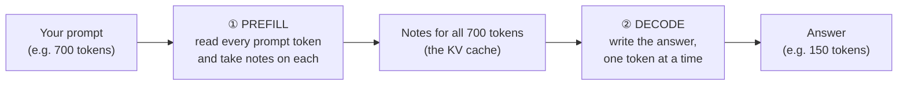
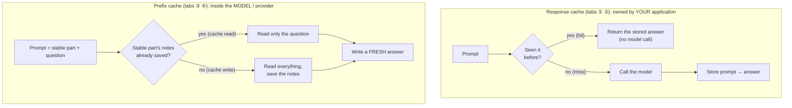
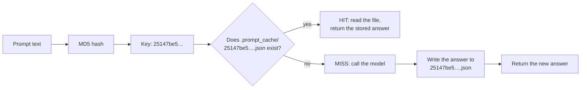
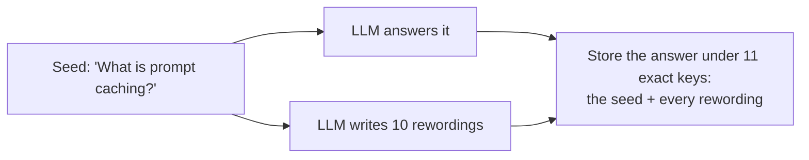
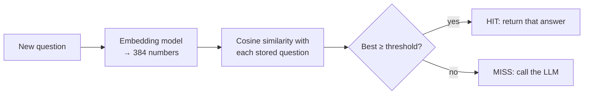
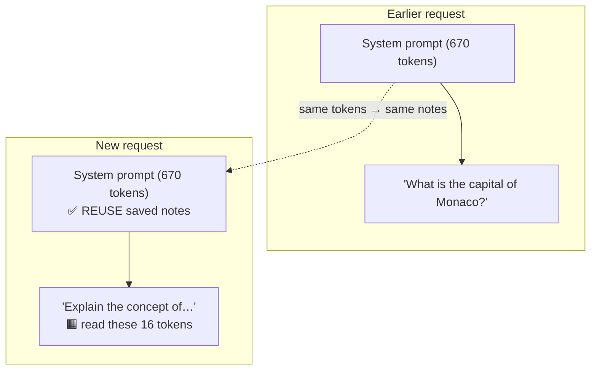
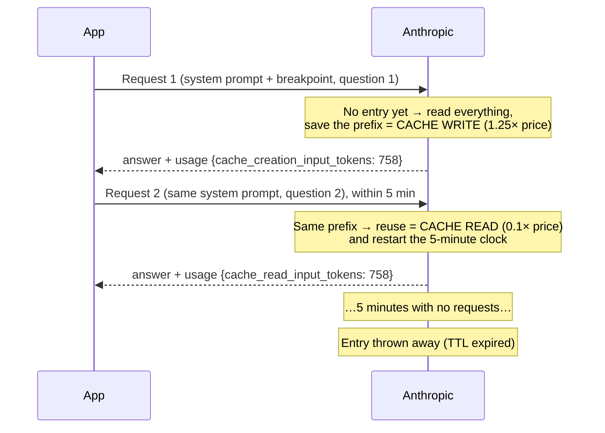
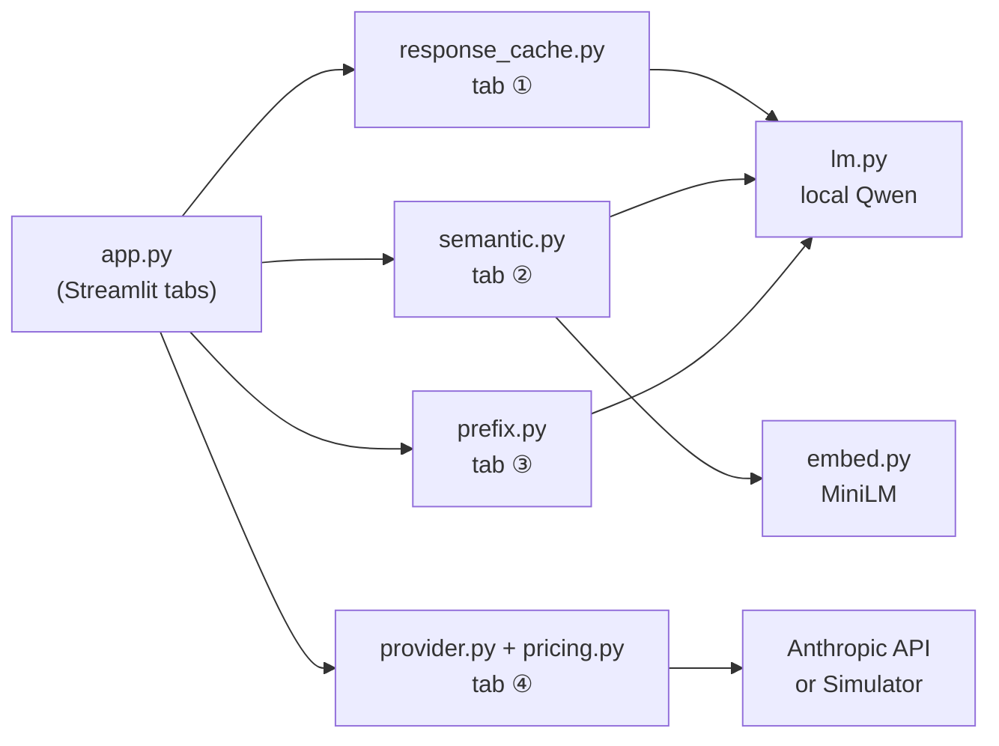

# How Prompt Caching Works: a Beginner's Guide

This guide explains **prompt caching** from the ground up and walks through every part of the Prompt
Caching Explorer app. You don't need a machine-learning background. If a word is unfamiliar, check the
[glossary](../GLOSSARY.md).

> **The 30-second version.** Every time you send a prompt to an LLM, you pay (in money and in waiting)
> for two things: the model **reading** your prompt and the model **writing** its answer. *Prompt caching*
> means not paying twice for work that has already been done. There are two very different ways to do it:
>
> 1. **Reuse the whole answer.** If someone asks the same question again, hand back the answer you saved
>    last time. The model isn't called at all. This is a **response cache** (tabs ① and ②).
> 2. **Reuse the reading.** If a new prompt *starts* with the same long text as an earlier one (the same
>    instructions, the same document), skip re-reading that part. The model still writes a fresh answer.
>    This is a **prefix cache** (tabs ③ and ④).
>
> The book's folder mixes both under one name. Keeping them apart is the most useful thing you can take
> from this guide.

---

## Contents

1. [What happens when you send a prompt](#1-what-happens-when-you-send-a-prompt)
2. [The two families of prompt caching](#2-the-two-families-of-prompt-caching)
3. [Tab ①: exact-match response cache](#3-tab--exact-match-response-cache)
4. [Tab ②: paraphrase pre-population vs semantic cache](#4-tab--paraphrase-pre-population-vs-semantic-cache)
5. [Tab ③: prefix (KV) cache](#5-tab--prefix-kv-cache)
6. [Tab ④: provider prompt caching (Anthropic)](#6-tab--provider-prompt-caching-anthropic)
7. [What about OpenAI?](#7-what-about-openai)
8. [Where the app differs from the book's scripts](#8-where-the-app-differs-from-the-books-scripts)
9. [All four techniques side by side](#9-all-four-techniques-side-by-side)
10. [How the app is built](#10-how-the-app-is-built)
11. [A checklist for your own projects](#11-a-checklist-for-your-own-projects)

---

## 1. What happens when you send a prompt

### Tokens

A model doesn't read letters or whole words. It reads **tokens**: chunks of text that are often a
word with its leading space (`␣caching`), sometimes a piece of a word (`Ex` + `plain`), sometimes
punctuation or a line break. A rough rule for English is **1 token ≈ 4 characters ≈ ¾ of a word**.

Tokens matter because **everything is counted in tokens**: API prices are "dollars per million tokens",
and the time a model takes grows with the number of tokens.

### Two phases: reading, then writing

When a prompt arrives, the model works in two phases:



1. **Prefill (reading).** The model processes all the prompt tokens. For each token it computes and
   keeps some internal numbers, a bit like notes in the margin. These notes are called the
   **KV cache** ("K" and "V" stand for *keys* and *values*, the two kinds of numbers it saves per token).
   This phase decides how long you wait before the **first** word of the answer appears.
2. **Decode (writing).** The model produces the answer one token at a time. To choose each new token it
   looks back over all its notes, so it never has to re-read the prompt. This phase decides how long
   the answer takes to finish.

### Why this costs money

API providers charge separately for **input tokens** (the prompt, the prefill) and **output tokens**
(the answer, the decode). Real applications often send a **long, mostly unchanging prompt** (a
2,000-word set of instructions, a product manual, a whole codebase) followed by a **short, changing
question**. Without caching, the model re-reads that long unchanging text on every request, and you pay
for it every time.

> **Keep this picture in mind:** *a long stable part + a short changing part.* Prefix caching (tabs ③ and
> ④) exists for exactly that shape of prompt.

---

## 2. The two families of prompt caching

An everyday comparison: a busy café.

- **Response cache = the "already made" shelf.** Someone orders a plain black coffee, which is the most
  common order. The barista makes extra and puts cups on a shelf. The next person who orders *exactly*
  a plain black coffee gets one from the shelf instantly. Nobody makes anything. But if you order "black
  coffee, slightly less hot", the shelf can't help you.
- **Prefix cache = the prep station.** Every sandwich starts with the same bread, butter and lettuce, so
  the cook prepares a stack of buttered, lettuced bread in advance. When your order comes in ("…with
  chicken", "…with cheese"), the cook only adds your filling. Every customer still gets a freshly made,
  different sandwich, just faster.



| | Response cache | Prefix cache |
|---|---|---|
| What is reused | The **final answer** | The model's **notes** (KV cache) on the start of the prompt |
| Is the model called on a reuse? | **No** | **Yes**, it still writes an answer |
| Answer on a reuse | The *same* old answer | A *new* answer to the new question |
| What must match | The whole prompt (exactly, or by meaning) | Only the **beginning** of the prompt, exactly |
| Who builds it | You, in your application code | The model server / API provider |
| Book scripts | `basic_cache.py`, `semantic_cache.py` | `anthropic_cache.py`, `openai_example_*.py` |

---

## 3. Tab ①: exact-match response cache

### The idea

Keep a notebook of **prompt → answer**. Before calling the model, look up the prompt. If it's there,
return the stored answer. If not, call the model and write the new answer down.

To look things up quickly, the prompt is turned into a **cache key** using a *hash function*. The book
uses **MD5**. A hash function is a fingerprint machine:

- The same text **always** gives the same fingerprint: `"Explain the concept of prompt caching in AI systems."`
  → `25147be5f5bac50f47b93bea358762ff`.
- Change **anything**, even one invisible space, and you get a completely unrelated fingerprint.
- The fingerprint is always 32 characters, however long the prompt, so it makes a tidy file name.



This is exactly what `get_completion()` in the book's `basic_cache.py` does. The app's version is in
`cache_lab/response_cache.py`.

### Using the tab

| Control | What it does |
|---|---|
| **Prompt** | The text to send. It defaults to the book's example prompt. |
| **Max answer tokens** | Caps the answer length, so a miss doesn't take too long. |
| **Use the cache** | Off = always call the model (the book's `use_cache=False`). Useful to see the "no cache" time again. |
| **Ask** | Runs `get_completion`: a lookup, then a model call on a miss. |
| **Near misses** table | Shows lookalike prompts and whether they would hit. It only looks; it never calls the model. |
| **What's in the cache folder** | Lists the files in `.prompt_cache/` and shows one exactly as stored. **Clear the cache** deletes them. |

### A real example from the app

Click **Ask** twice with the default prompt (Qwen2.5-0.5B on a laptop CPU):

| # | Result | Time to answer |
|---|---|---|
| 1 | 🟠 miss: the model wrote the answer | **5.26 s** |
| 2 | 🟢 hit: the answer was read from disk | **0.1 ms** |

The hit was about **85,000× faster**, because reading a small file is nothing next to running a model.
With a paid API there's a second win: a hit costs **$0**.

The stored file looks like this:

```json
{
  "key": "25147be5f5bac50f47b93bea358762ff",
  "prompt": "Explain the concept of prompt caching in AI systems.",
  "content": "Prompt caching is a technique used in artificial intelligence (AI) systems to ...",
  "model": "Qwen/Qwen2.5-0.5B-Instruct",
  "created_at": 1762606990.1,
  "generation_seconds": 5.26
}
```

### The catch: "the same" means *character for character*

Here is the near-miss table from the app. Each variant means the same thing to a person:

| Change | Prompt (quotes show spaces) | MD5 key | Lookup |
|---|---|---|---|
| identical | `'Explain the concept of prompt caching in AI systems.'` | `25147be5…` | 🟢 hit |
| trailing space | `'Explain the concept of prompt caching in AI systems. '` | `fd4bfb8c…` | 🔴 miss |
| all lowercase | `'explain the concept of prompt caching in ai systems.'` | `9fd09506…` | 🔴 miss |
| double space | `'Explain  the concept of prompt caching in AI systems.'` | `0faa2de8…` | 🔴 miss |
| different ending | `'Explain the concept of prompt caching in AI systems?'` | `34a74580…` | 🔴 miss |
| leading "Please " | `'Please explain the concept of prompt caching in AI systems.'` | `a4508a02…` | 🔴 miss |

One extra space makes a completely different key. Real users almost never type exactly the same thing
twice, so a plain exact-match cache mostly helps when **the prompt is generated by code**: a fixed button
("Summarise this page"), a nightly batch job that may re-run, a test suite, a product page that many
visitors open.

> **Cheap improvement:** *normalise* the prompt before hashing (trim spaces, lowercase, collapse double
> spaces). That fixes the first three rows above for free. It can't fix rewordings; that's tab ②.

### Things the simple version gets wrong (and you should not copy blindly)

1. **The key ignores everything except the prompt.** The book hashes only the user's text. If you change
   the model, the system prompt, the temperature or `max_tokens`, you still get the *old* answer. In a
   real system, hash **all** of these together.
2. **Answers never expire.** Ask "what's today's top news?" and you'll get yesterday's answer forever. Give
   entries an expiry time (a **TTL**), or don't cache time-sensitive questions.
3. **Answers are shared between users.** If the prompt includes anything personal, one user could receive
   another's answer. Put the user or tenant ID in the key, or don't cache personal prompts.
4. **You freeze one answer.** If a model gives varied answers (temperature above 0), the cache always
   returns the first one. That's usually fine, but it's a choice.

---

## 4. Tab ②: paraphrase pre-population vs semantic cache

Tab ① misses whenever the wording changes. This tab compares two ways of making a response cache
tolerate rewordings.

### Approach A: paraphrase pre-population (the book's `semantic_cache.py`)

On a miss, the book's code does two things: it answers the question, **and** it asks an LLM: *"give me 10
alternative requests for this prompt"*. Then it stores **the same answer** under the original prompt and
under each of the 10 rewordings.



The name in the book says "semantic", but **lookups are still exact-match**. A later question hits only if it
is *character for character* one of the 11 stored strings. That's why this guide calls it **paraphrase
pre-population** and not semantic caching. It's a guess at what users might type, made in advance.

### Approach B: a real semantic cache

A semantic cache compares questions by **meaning**. It does this with **embeddings**.

**An embedding is a list of numbers that describes what a sentence means**, produced by a small model
(the app uses `all-MiniLM-L6-v2`, which turns any sentence into 384 numbers). Picture each sentence as a
point on a map: sentences about similar things land close together, unrelated sentences land far apart.

**Cosine similarity** measures how close two points are, as a number usually between 0 and 1:

- **1.0** means "pointing the same way" (the same meaning, as far as the model can tell);
- **around 0** means unrelated.

The semantic cache stores the seed question's embedding. For each new question it computes the
similarity and **hits if the similarity is at or above a threshold** (the app's default is 0.85).



### Using the tab

| Control | What it does |
|---|---|
| **Seed question** | The question that gets answered and cached by both approaches. |
| **Rewordings (N)** | How many paraphrases the local model writes for approach A (the book uses 10). |
| **Similarity threshold** | The cut-off for approach B. Moving it updates the results instantly, with no rerun needed. |
| **Build both caches** | Answers the seed, writes the rewordings, and stores everything. |
| **Test questions** | An editable table. Tick **same meaning?** when the cached answer would be a *correct* reply. This is your judgement, and the app uses it to grade each lookup. |

Each lookup gets one of four verdicts:

| | Hit | Miss |
|---|---|---|
| **Same meaning** | ✅ correct hit | ⚠️ missed reuse: called the LLM when you didn't need to (wastes money) |
| **Different meaning** | ❌ **false hit**: returned the answer to a different question (**wrong**) | ✅ correct miss |

A missed reuse costs a little money. A **false hit gives the user a wrong answer**, which is much worse.

### A real example from the app (seed "What is prompt caching?", threshold 0.85)

The local model's 10 rewordings included:

- *What is the purpose of prompt caching in programming?*
- *What are the benefits of using prompt caching?*
- *How can I optimize my code by using prompt caching?*
- *What is prompt caching and how does it work?*

Results:

| Test question | Same meaning? | Paraphrase cache | Similarity | Semantic cache |
|---|---|---|---|---|
| What is prompt caching? | yes | ✅ hit | 1.000 | ✅ hit |
| what is prompt caching | yes | ⚠️ miss | 0.986 | ✅ hit |
| Can you explain what prompt caching is? | yes | ⚠️ miss | 0.971 | ✅ hit |
| Explain the concept of prompt caching in AI systems. | yes | ⚠️ miss | **0.766** | ⚠️ miss |
| How does prompt caching reduce API costs? | no | ✅ miss | 0.788 | ✅ miss |
| Is prompt caching worth it? | no | ✅ miss | 0.790 | ✅ miss |
| What is **not** prompt caching? | **no** | ✅ miss | **0.959** | ❌ **false hit** |
| What is response caching? | no | ✅ miss | 0.717 | ✅ miss |
| What is the capital of France? | no | ✅ miss | 0.071 | ✅ miss |

What this shows:

1. **The paraphrase cache missed 3 of the 4 questions that meant the same thing.** Even 10 guesses rarely
   match what a real person types, character for character.
2. **The semantic cache caught small changes** (lowercase, "Can you explain…") with no guessing at all.
3. **"What is *not* prompt caching?" scored 0.959**, higher than the genuinely equivalent "Explain the
   concept of prompt caching…" (0.766). Embeddings capture the *topic* very well but are bad at small
   words that flip the meaning ("not", "without", "before/after").
4. **No threshold gets every row right.** To catch the 0.766 question you'd have to go below 0.788 and 0.790,
   which would also return the wrong answer for "reduce API costs" and "worth it". Drag the slider and
   watch the chart: the green and red bars overlap.

### A hidden risk in the paraphrase approach

Look again at the rewordings above. *"What are the benefits of using prompt caching?"* is **not** the same
question as *"What is prompt caching?"*, yet the paraphrase cache will now answer it with the definition.
The book's paraphrase prompt even asks for requests that are *"different from the original prompt, but
still related to the same topic"*, which invites exactly this. **Every rewording that drifts in meaning is a
false hit waiting to happen**, and nobody checks them. A smaller model drifts more, but even a strong one
needs a strict instruction ("same meaning, only different words") and ideally a review.

The paraphrase approach also **costs an extra LLM call on every miss** (to write the rewordings), even if
none of them is ever used.

### When to use which

- **Exact-match (tab ①)**: always safe, and a good first layer. Use it when prompts come from code.
- **Semantic cache**: good for **FAQ-style** traffic (support bots, documentation questions) where many
  people ask the same few things in different words, and where an occasional slightly-off answer is
  tolerable. Start with a **high** threshold (0.9 to 0.95), log the hits, and check them. Never use it where
  a false hit is dangerous (medical, legal, account-specific answers).
- **Paraphrase pre-population**: rarely the best choice. It has the cost of an extra LLM call, the
  false-hit risk of drifting rewordings, and the rigidity of exact matching.

---

## 5. Tab ③: prefix (KV) cache

Tabs ① and ② reuse **answers**, which only helps when the *question* repeats. But most real traffic is
**different questions on top of the same long instructions**. For that we need to reuse the model's
**reading**, not its answer.

### The idea, step by step

Remember from section 1 that during **prefill** the model makes notes (the KV cache) for every token
of the prompt. Here's the key fact:

> **The notes for a token depend only on that token and the tokens *before* it, never on the tokens after it.**

Language models read strictly left to right. So if two prompts begin with the same 670 tokens, the notes for
those 670 tokens are **identical** in both. We can compute them once, keep them, and for the next prompt
only read the tokens that come after.



The flip side is just as important:

> **Reuse stops at the first token that differs. Everything after it must be recomputed, even if the rest
> is identical again**, because every later token's notes depended on the changed one.

This is like a domino line: change one domino and every domino after it falls differently.

### What the model actually reads

Chat models wrap your messages in a fixed template. Qwen's looks like this:

```
<|im_start|>system
{system prompt}<|im_end|>
<|im_start|>user
{question}<|im_end|>
<|im_start|>assistant
```

The system prompt comes **first**, so a long, unchanging system prompt is a ready-made shared prefix.

### Using the tab

| Control | What it does |
|---|---|
| **Earlier request: question** | Combined with the book's long system prompt and read once; its KV cache is saved (the "cache write"). |
| **New request: question** | The request we want to answer now. |
| **What else differs?** | *Only the question* (the good layout), *a timestamp at the top of the system prompt* (a classic mistake), or *one character inside the system prompt* (with a slider for where). |
| **Answer tokens to generate** | How much of each answer to write, to check the two answers match. |
| **Run both prefills** | Times the new request's prefill **from scratch** and **reusing the saved cache** (median of 3 runs), then writes an answer from each. |

The **token strip** shows the new prompt token by token: 🟩 green tokens were reused, 🟧 orange tokens were
recomputed, and the red outline marks the first token that differs.

### Real examples from the app (Qwen2.5-0.5B, laptop CPU)

**1. Only the question changes (the good layout)**

| | |
|---|---|
| Tokens in the new prompt | 686 |
| Reused from the cache | **670 (98%)** |
| Recomputed | 16 |
| Prefill from scratch | 1.12 s |
| Prefill reusing the cache | 0.31 s |
| **Speed-up** | **3.6×** |
| One-off cost to build the cache | 0.95 s (paid once by the earlier request) |

The shared part ends exactly at the end of the system prompt: `…␣accuracy <|im_end|> ⏎ <|im_start|> user ⏎`,
and then the new question begins. Both answers were **identical** (the biggest difference in the model's
scores was 0.00003, which is floating-point rounding). **Reusing the cache changes the speed, never the answer.**

(Why only 3.6× and not 40×, when 98% of the work was skipped? On a small model on a CPU, each model call
has a fixed overhead of roughly 0.1 to 0.3 seconds, whatever its size. On big models on servers, where
reading 100,000 tokens can take many seconds, the savings are much larger.)

**2. A timestamp at the top of the system prompt**

The system prompt starts with `Current time: 2026-11-08 09:00:00` in the earlier request and `…09:00:07`
in the new one: seven seconds later.

| | |
|---|---|
| Reused | **25 of 710 tokens** |
| Recomputed | 685 |
| Speed-up | 1.2× (basically nothing) |

The 25 reused tokens are `<|im_start|> system ⏎ Current ␣time : ␣ 2 0 2 6 - 1 1 - 0 8 ␣ 0 9 : 0 0 : 0`,
everything up to the last digit of the seconds. One changed digit at the start threw away the whole
system prompt. **This is the most common way people accidentally break prompt caching.**

**3. One character changed in the middle of the system prompt**

At the 50% position, "Consider **d**ifferent viewpoints" became "Consider **dX**fferent viewpoints".

| | |
|---|---|
| Reused | **329 of 689 tokens** (everything before the change) |
| Recomputed | 360 (everything after it, though it's identical text) |
| Speed-up | 1.5× |

### The rule this teaches

> **Put what never changes first and what changes last.**
>
> Good order: fixed instructions → tool definitions → long documents or examples → conversation
> history → the new question.
>
> Things that silently break the prefix if they're near the top: timestamps, request IDs, the user's name,
> "today's date", randomly shuffled examples, a dictionary whose key order isn't fixed.

---

## 6. Tab ④: provider prompt caching (Anthropic)

### The idea

Tab ③, but on the provider's servers. You can't see their KV cache, but you can **ask** them to keep it and
you **pay less** when they reuse it.

With Anthropic you mark the end of the stable part with a **cache breakpoint**, a `cache_control` field
on a content block:

```python
client.messages.create(
    model="claude-haiku-5-5",
    max_tokens=150,
    system=[{
        "type": "text",
        "text": LONG_SYSTEM_PROMPT,
        "cache_control": {"type": "ephemeral"},          # ← "cache everything up to here"
        # for a 1-hour lifetime: {"type": "ephemeral", "ttl": "1h"}
    }],
    messages=[{"role": "user", "content": "What is the capital of Monaco?"}],
)
```

What happens then:



### The rules (Anthropic, checked 2026-11-08)

| Rule | Detail |
|---|---|
| **You must ask** | No `cache_control` means no caching. (There's also an "automatic" mode: put one `cache_control` at the top level of the request and the API places the breakpoint on the last block for you. It's handy for long chats.) |
| **Exact match** | The prefix must be 100% identical, including tools, system prompt and earlier messages, in the same order. |
| **Minimum length** | Claude Haiku/Sonnet/Opus 5.5: **512 tokens**. Some older models need 1,024 to 4,096. A shorter prefix is **silently not cached**: no error, both counters stay 0. |
| **TTL** | 5 minutes by default; `"ttl": "1h"` for 1 hour. Every read restarts the clock for free. |
| **Breakpoints** | Up to 4 per request (for example: tools, then system, then documents, then history). |

### Reading the `usage` numbers

Every response tells you what happened, in three input counters:

| Field | Meaning | Price (vs normal input) |
|---|---|---|
| `cache_creation_input_tokens` | Tokens **written** to the cache this time (`cache_creation` splits them by 5m / 1h) | **1.25×** (5m) or **2×** (1h) |
| `cache_read_input_tokens` | Tokens **reused** from the cache | **0.1×** (0.05× on Sonnet/Opus 5.5) |
| `input_tokens` | Tokens **after** the last breakpoint, never cached | 1× |

**Total prompt size = `input_tokens` + `cache_creation_input_tokens` + `cache_read_input_tokens`.** People
are often surprised that `input_tokens` is tiny on a cached request. It only counts the part after the
breakpoint.

### Prices used by the app ($ per million tokens)

| Model | Normal input | 5-min write | 1-hour write | Cache read | Output |
|---|---|---|---|---|---|
| claude-haiku-5-5 | 0.10 | 0.125 | 0.20 | 0.01 | 0.50 |
| claude-sonnet-5-5 | 2.00 | 2.50 | 4.00 | 0.10 | 10.00 |
| claude-opus-5-5 | 4.00 | 5.00 | 8.00 | 0.20 | 20.00 |

(From Anthropic's pricing page on 2026-11-08. Haiku's prices are for prompts up to 100,000 tokens. You can
edit the table in the app's sidebar.)

### Using the tab

| Control | What it does |
|---|---|
| **Claude model** | Which model to call (and whose prices to use). |
| **Request style** | *No cache_control* reproduces the book's original script; *Cache breakpoint on the system prompt* is the fixed version. |
| **TTL** | 5 minutes or 1 hour. |
| **System prompt** | The book's prompt, the book's prompt ×4 (a bigger stable part), or a short prompt below the 512-token minimum. |
| **Questions** | One request per line, sent in order. Different questions are realistic: the prefix is reused even though every question differs. |
| **max_tokens** | The cap on each answer. |
| **Send requests** | Sends them (or simulates them, see below) and adds them to the results table. **Clear results** empties it. |

The tab also shows the **estimated worst-case cost** before you click, the exact request JSON, a stacked
chart of token types per request, and **when the cache entry will expire**.

> **Simulation mode.** With no API key, the app doesn't send anything. It estimates tokens (about 4
> characters per token), applies the rules above (minimum length, write then read, TTL expiry) and the real
> prices, and labels every row as *simulated*. Latency isn't simulated, because it can't be faked honestly.
> The numbers below come from simulation mode. With a real key, the token counts will differ slightly
> (Claude's tokenizer isn't "4 characters per token"), but the pattern is the same.

### A worked example (Haiku 5.5, the book's system prompt, 3 different questions)

The book's system prompt is about **758 tokens**, above Haiku 5.5's 512-token minimum. Each answer is capped at 150 tokens.

| # | Question | Result | input | cache write | cache read | output | Cost | Cost without caching |
|---|---|---|---|---|---|---|---|---|
| 1 | What is the capital of Monaco? | ✍️ write | 16 | 758 | 0 | 150 | $0.000171 | $0.000152 |
| 2 | What is prompt caching? | 📖 read | 14 | 0 | 758 | 150 | $0.000084 | $0.000152 |
| 3 | Name three uses of a cache. | 📖 read | 15 | 0 | 758 | 150 | $0.000084 | $0.000152 |

Here is the arithmetic for request 1, in millionths of a dollar:
`16 × 0.10 (input) + 758 × 0.125 (write) + 150 × 0.50 (output) = 1.6 + 94.75 + 75 = 171.35` → **$0.000171**.
Without caching it would be `774 × 0.10 + 75 = 152.4`, so **the first request costs a bit more** (the
write premium).

Request 2: `14 × 0.10 + 758 × 0.01 + 75 = 1.4 + 7.58 + 75 = 83.98` → **$0.000084**, about **half** the
uncached price.

Two things to notice:

- **Caching only discounts input.** Here the 150 output tokens ($0.000075) are a big share of each bill, so
  the total saving over 3 requests is about 26%. Counting **input alone**, the cost fell by about half,
  and the saving grows with every extra request.
- **Bigger stable parts save more.** With the ×4 system prompt (about 3,034 tokens), each read costs $0.000107
  instead of $0.000380 uncached: **72% off every request after the first**.

### When does it pay off?

A cache write costs a little more than normal input, and every read saves a lot. With 5-minute writes on
Haiku:

- extra cost of a write = 1.25 − 1 = **0.25×** the normal price;
- saving per read = 1 − 0.1 = **0.9×**;
- **break-even = 0.25 / 0.9 ≈ 0.28 reads.** In other words, **one single reuse already pays for the write.**

For 1-hour writes: (2 − 1) / 0.9 ≈ **1.1 reads**. You need two reuses within the hour.

Over many requests the input saving approaches 90%. For N requests sharing a prefix of P tokens:

| Requests in a row | Input cost with caching | Without | Saved |
|---|---|---|---|
| 1 | 1.25 P | 1 P | −25% (only a write) |
| 2 | 1.25 + 0.1 = 1.35 P | 2 P | 33% |
| 10 | 1.25 + 0.9 = 2.15 P | 10 P | 78% |
| 100 | 1.25 + 9.9 = 11.15 P | 100 P | 89% |

**When it doesn't pay:** prompts below the minimum; a prefix that changes every time (see tab ③'s
timestamp example); requests spaced further apart than the TTL; one-off requests with no repeat.

### The three things to try in the tab

1. **Request style = No cache_control** → every row says "nothing cached", however long the prompt is.
   This is what the book's `anthropic_cache.py` does.
2. **System prompt = short** with a breakpoint → still nothing cached, and no error. The app warns you,
   but the API won't.
3. **The ×4 system prompt** with a breakpoint → one write, then cheap reads. Change the model to Sonnet to
   see the reads get an even bigger discount (0.05×).

### Why would a provider give a discount?

A fair question: providers charge per token, so wouldn't they *want* you to send as many tokens as
possible? It looks that way, but providers don't really sell tokens. They sell **GPU time**, and tokens
are just how they bill for it. (What follows is reasoning about the economics; providers don't publish
their margins.)

1. **Re-reading the same prefix costs the provider real money.** Every input token means GPU work: the
   prefill from tab ③. Send a 10,000-token system prompt 100 times and they do that work 100 times. With
   caching they do it once, and after that the work is mostly fetching saved KV data, which is far cheaper
   than recomputing it. A cache read is billed at 0.1× the normal price, but their cost probably drops by a
   similar or larger factor. They earn less per request, but not necessarily less **profit** per request.
2. **GPUs are the bottleneck, not demand.** Providers are short of capacity. Every GPU-second not spent
   re-reading your unchanged prompt can serve another paying request. Caching gets them **more revenue
   from the same hardware**: they're not losing money, they're freeing up capacity.
3. **Cheaper tokens make people use more of them.** Many of today's biggest uses only pay off because of
   caching:
   - coding assistants that resend a whole codebase on every turn;
   - agents that resend a growing conversation history 50 times in one task;
   - chatbots with long instructions or a product manual attached.

   Without caching, a lot of these would be too expensive or too slow to build. With it, people build them
   and send far *more* total tokens. Cutting the price of each token grows the overall market.
4. **The pricing protects them.**
   - **Cache writes cost extra** (1.25× or 2×), which covers the memory needed to hold your KV data.
   - **The TTL** (5 minutes or 1 hour) means they only hold memory for prefixes that are actually being reused.
   - **The minimum length** (512+ tokens) means they don't bother with tiny prefixes that aren't worth storing.

   That's why the worked example above showed the first request costing *more* than an uncached one.
5. **Competition.** Prefix caching is a well-known technique that open-source servers like vLLM already
   include. Any provider that refused to pass on the savings would be undercut by one that did. Lower
   latency also matters: a faster first word is a better product.

> **In short:** the business is selling useful work per GPU, not as many tokens as possible. Caching gets
> more useful work out of each GPU, which is why every major provider offers it.

---

## 7. What about OpenAI?

OpenAI also offers provider prompt caching, but it works differently:

| | Anthropic | OpenAI |
|---|---|---|
| Turning it on | **Explicit** `cache_control` breakpoints (or one top-level automatic marker) | **Automatic** for prompts of **1,024 tokens or more**; nothing to add |
| Write premium | Yes (1.25× or 2×) | No |
| Read discount | 90% (95% on Sonnet/Opus 5.5) | Depends on the model; see OpenAI's pricing page |
| How you can tell | `cache_creation_input_tokens`, `cache_read_input_tokens` | `usage.prompt_tokens_details.cached_tokens` |
| Lifetime | 5 min or 1 h, refreshed on each read | Usually minutes of inactivity; longer retention options exist on some models |
| Same rule | **Stable part first, exact prefix match** | **Stable part first, exact prefix match** |

OpenAI also accepts a `prompt_cache_key` parameter, which helps it send requests that share a prefix to the
same server, so they're more likely to hit.

The book's two OpenAI scripts don't show any of this correctly; see the next section. The app doesn't make
OpenAI calls, because the mechanism is the same one tab ③ shows and tab ④ prices.

---

## 8. Where the app differs from the book's scripts

The book's folder is a quick sketch, and a few of its scripts don't do what they appear to. The app keeps
the ideas and fixes the mechanics:

| Book script | What it does | Problem | In the app |
|---|---|---|---|
| `basic_cache.py` | MD5-keyed JSON file cache | Works. The key covers only the prompt, not the model or settings, and nothing expires. | Tab ① uses the same idea and shows its limits (section 3). |
| `semantic_cache.py` | Stores the answer under 10 LLM-written "alternative requests" | **Not semantic**: lookups are still exact-match. The prompt asks for *different* requests, which invites false hits. It costs an extra LLM call per miss. The JSON parsing crashes if the reply isn't in a ```json block. | Tab ② runs it next to a real embedding-based semantic cache (section 4). |
| `anthropic_cache.py` | Sends the same request 3 times and prints cache counters | **No `cache_control` anywhere, so nothing is ever cached.** Both counters print 0. Also, the model it used (Claude 3.7 Sonnet) needed at least 1,024 tokens to cache, and the system prompt is only about 750, so even with `cache_control` it would not have cached. It compares answer text to "prove" caching, but prefix caching never makes answers identical; it only changes cost and speed. | Tab ④'s *No cache_control* style reproduces it; the breakpoint style fixes it (section 6). |
| `openai_example_server.py` | 5 identical requests with `"cache_control": "force-cache"` | **`cache_control` is not an OpenAI parameter.** The request fails, and the script quietly retries without it. Timing differences between runs mostly reflect network and server noise. The real signal is `usage.prompt_tokens_details.cached_tokens`, which it never prints. | Explained in section 7. |
| `openai_example_client.py` | Sets `OPENAI_CACHE_DIR` and expects faster calls | **The OpenAI SDK has no such setting.** Nothing is cached locally, and any speed-up is coincidence (or OpenAI's automatic caching, which needs 1,024+ tokens; this prompt is far shorter). | Section 7; tab ① shows what a real local cache looks like. |

Other differences:

- The app uses a **local Qwen model** instead of Claude for tabs ① to ③ (free, and in tab ③ the KV cache can
  actually be inspected). See [ADR 0001](adr/0001-hybrid-local-and-anthropic.md).
- The paraphrases in tab ② are written by the local model, not Claude, so they are rougher. That makes the
  meaning-drift risk easier to see.

---

## 9. All four techniques side by side

| | ① Exact-match response cache | ② Semantic response cache | ③ / ④ Prefix cache (local / provider) |
|---|---|---|---|
| **Reuses** | the whole answer | the whole answer | the model's reading of the prompt's start |
| **Hits when** | the prompt is identical | the prompt means *roughly* the same | the prompt *starts* with an identical prefix |
| **Model called on a hit?** | no | no | yes |
| **Saves** | 100% of cost and time | 100% of cost and time | most input cost and time-to-first-token; output still paid |
| **Risk of a wrong answer** | none (beyond stale or shared answers) | **false hits** | none: same answer as without caching |
| **Works with different questions?** | no | only similar ones | **yes**: that's the point |
| **Who runs it** | you | you | the model server / provider |
| **Best for** | prompts made by code, re-runs, tests | FAQ-style traffic | long fixed instructions or documents + changing questions; chats; agents |

These layers stack. A production app might check an exact-match cache, then (for low-risk FAQs) a
semantic cache, and send everything else to a provider with prompt caching switched on.

---

## 10. How the app is built



- **`lm.py`** is the only code that touches the local model. Its `prefill(ids, reuse=…, reuse_tokens=…)` reads
  a prompt and, if given a saved KV cache, **copies it, trims it to the shared prefix, and reads only the
  rest**. The saved cache is never modified, so it can be reused again and again.
- **`prefix.py`** finds the shared prefix (`shared_prefix_len` compares token IDs one by one) and runs the
  timed comparison.
- **`response_cache.py`** and **`semantic.py`** contain no model code. The model and embedder are passed in,
  which keeps them easy to test.
- **`pricing.py`** turns a `usage` into a cost broken down by token type, and **`provider.py`** builds
  requests, reads the usage counters, and holds the simulator.
- The tests (`uv run pytest`) check hashing and near misses, threshold behaviour and false hits, cost
  arithmetic, the simulator's write/read/expire rules, and that KV reuse gives **identical output**
  on the real model.

---

## 11. A checklist for your own projects

1. **Shape your prompt for prefix caching first.** It's free to get right and has no correctness risk:
   stable content first, changing content last, no timestamps or IDs near the top.
2. **Turn on provider caching**: add `cache_control` (Anthropic), or simply make sure the stable part is
   long enough (OpenAI, 1,024+ tokens). Check that the prefix is above the model's **minimum length**.
3. **Verify it from `usage`, not from timing.** Look for `cache_read_input_tokens > 0` (Anthropic) or
   `cached_tokens > 0` (OpenAI) on the second request. Timing is noisy; counters aren't.
4. **Pick the TTL from your traffic.** Requests every few minutes → 5 min. Bursts with longer gaps → 1 hour.
5. **Add an exact-match response cache** for prompts built by code. Hash *everything* that affects the
   answer (model, system prompt, settings), add an expiry, and keep users' data apart.
6. **Consider a semantic cache only for low-risk, repetitive questions.** Start with a high threshold, log
   every hit, and check for false hits, especially with negations ("not", "without").
